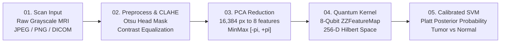

# QSVM Med • Project Documentation & Technical Specification

> **Research Prototype**: Simulated 8-Qubit Quantum-Kernel Support Vector Machine for Brain Tumor MRI Screening compared side by side with a Tuned Classical SVM.  
> **Status**: Live Backend Deployed on Render (`https://qsvm-med.onrender.com`)  
> **Disclaimer**: Academic research prototype. Not certified for clinical medical diagnosis.

---

## 1. Executive Summary

Brain tumor screening from magnetic resonance imaging (MRI) is complicated by high inter-tissue contrast variance, diffuse borders, and overlapping pixel intensity distributions between neoplastic tissue and healthy brain parenchyma. Standard classical machine learning models trained on reduced dimensional representations often face non-linear decision boundary challenges.

**QSVM Med** is an academic research platform developed to evaluate whether quantum machine learning—specifically a simulated quantum kernel computed via an 8-qubit $ZZ\text{FeatureMap}$—can offer enhanced class separability over traditional Euclidean kernels when operating on low-dimensional image projections. 

The system performs head-to-head evaluation between:
1. **Quantum SVM (QSVM)**: Simulated 8-qubit statevector fidelity kernel with Platt probability calibration.
2. **Classical Baseline SVM**: Scikit-learn Support Vector Classifier with a Radial Basis Function (RBF) kernel optimized via 5-fold Grid Search.

---

## 2. Research Team

| Member | Role | Key Responsibilities |
| :--- | :--- | :--- |
| **Kartikey Mishra** | **Quantum ML & Research** | Quantum circuit formulation, 8-qubit $ZZ\text{FeatureMap}$ fidelity kernel simulation, Platt posterior scaling, and hyperparameter tuning. |
| **Kunal** | **Frontend & Visualization** | Light teal research design system, interactive 2D radiology slice viewer, SVG dynamic overlays, and state telemetry. |
| **Kush** | **Backend & Pipeline** | FastAPI REST service architecture, image preprocessing pipelines, CLAHE normalization, and model orchestration. |
| **Kartikey** | **Dataset & Validation** | Kaggle MRI dataset curation, label verification, duplicate filtering, and held-out test split benchmarking. |
| **Gaurav** | **System Architecture & Research** | Classical RBF SVM baseline grid search, cloud deployment infrastructure on Render, and comparative metrics analysis. |

---

## 3. End-to-End 5-Stage Transformation Pipeline



### Stage 1: Ingestion & Sanity Checks
- Accepts axial brain MRI slices in raster (JPEG, PNG) or clinical DICOM formats (up to 15 MB).
- Input verification checks for unsuitable inputs (blank images, abnormal aspect ratios, extreme noise) to prevent out-of-distribution inference failures.

### Stage 2: Cranial Boundary Isolation & Intensity Normalization
- **Otsu Thresholding**: Isolates the intracranial contour, removing background scanner noise and black borders.
- **CLAHE (Contrast Limited Adaptive Histogram Equalization)**: Standardizes local tissue contrast across varying magnetic field strengths ($1.5\text{T}$ vs $3.0\text{T}$) without over-amplifying background noise (`clipLimit=2.0`, `tileGridSize=(8, 8)`).
- **Matrix Normalization**: Standardizes dimensions to $128 \times 128$ pixels ($16,384$ total intensity values).

### Stage 3: Principal Component Analysis (PCA)
- Compresses the $16,384$-dimensional flattened pixel vector into **8 orthogonal principal components** using `StandardScaler` and `PCA(n_components=8)`.
- Scales the 8 components into rotation angles $[-\pi, +\pi]$ radians ($\theta_0, \theta_1, \dots, \theta_7$) suitable for single-qubit quantum rotation gates.

### Stage 4: Quantum Feature Map & Kernel Simulation
- Employs an **8-qubit $ZZ\text{FeatureMap}$** with linear pairwise entanglement depth $d=2$.
- Features are encoded into quantum state amplitudes $|\psi(\mathbf{x})\rangle$ in a **$256$-dimensional complex Hilbert state space** ($\mathcal{H} = \mathbb{C}^{2^8}$).
- Evaluates the pairwise state fidelity inner product as the kernel matrix:
  $$K(\mathbf{x}_i, \mathbf{x}_j) = |\langle\psi(\mathbf{x}_i)|\psi(\mathbf{x}_j)\rangle|^2$$
- Executed via statevector matrix calculations in classical software simulation with Qiskit.

### Stage 5: Calibrated Support Vector Classification
- Solves the dual convex optimization problem across support vectors.
- Applies **Platt scaling** (logistic regression on raw decision margins $f(\mathbf{x})$) on a held-out validation split to output true posterior probabilities $P(\text{Tumor}|\mathbf{x})$ and $P(\text{Normal}|\mathbf{x})$.

---

## 4. Physical Lesion Localization & Explainability

Unlike black-box classifiers that provide only a global label, QSVM Med features an explainability and localization engine:

1. **Occlusion Sensitivity Heatmap**:
   - Slides a $24 \times 24$ pixel perturbation window (stride = 8) across the intracranial region.
   - Measures the drop in model probability when patches are blurred to generate a calibrated tissue importance saliency map.

2. **Intracranial Asymmetry & Parenchymal Contrast Analysis**:
   - Performs sagittal midline alignment to compare bilateral cranial symmetry ($L - R$ hemispheric difference).
   - Strips dense cortical bone peripheral shell ($>195$ intensity rim) to prevent false edge detections on the skull.
   - Evaluates parenchymal depth to isolate true focal masses within the brain tissue.

3. **Coordinate Metrics**:
   - **Centroid Coordinates**: Precise $(X, Y)$ pixel coordinates of the primary lesion center.
   - **Bounding Box**: $[X_{\min}, X_{\max}] \times [Y_{\min}, Y_{\max}]$ with corner calipers.
   - **Geometric Properties**: Area ($\text{px}^2$), equivalent diameter ($\text{px}$), and peak sensitivity intensity.
   - **Anatomical Mapping**: Identifies hemisphere and cranial quadrant (e.g., `Left Cranial Hemisphere • Medial / Parietal Temporal (Superior Anterior (Q2))`).

---

## 5. Model Training & Benchmark Results

### Dataset Details
- **Source**: Kaggle Brain Tumor MRI Dataset (*masoudnickparvar*).
- **Nature**: Authentic clinical MRI scans (not synthetic).
- **Total Images**: 6,878 images.
- **Training Split**: 4,598 images (85% train / 15% validation with patient duplicate leakage removed).
- **Test Split**: 1,468 held-out testing images.

### Head-to-Head Comparison (Measured on 1,468 Test Slices)

| Metric | QSVM (8-Qubit Quantum Kernel) | Classical SVM (Tuned RBF) | Delta |
| :--- | :---: | :---: | :---: |
| **Accuracy** | **94.01%** | **95.44%** | $-1.4\%$ |
| **Tumor Recall (Sensitivity)** | **95.08%** | **94.61%** | **$+0.47\%$** |
| **Tumor Precision** | **96.69%** | **99.12%** | $-2.43\%$ |
| **F1 Score** | **95.88%** | **96.82%** | $-0.94\%$ |
| **ROC-AUC** | **0.9674** | **0.9915** | $-0.024$ |
| **Specificity** | **91.05%** | **97.70%** | $-6.65\%$ |
| **Support Vectors Count** | 1,177 SVs | 1,054 SVs | $+11.7\%$ |
| **Average Inference Latency** | $\sim 32\text{ ms}$ (simulation) | $\sim 5\text{ ms}$ | - |

> **Key Research Finding**: The 8-qubit QSVM achieved higher tumor recall ($95.08\%$ vs $94.61\%$) on the compressed 8-feature representation, successfully detecting subtle pathological signals with higher sensitivity at the cost of slight precision trade-off.

---

## 6. Software Architecture & Technology Stack

### Frontend Architecture
- **Framework**: React 18, TypeScript, Vite.
- **Styling**: Tailwind CSS, Inter & JetBrains Mono typography.
- **Design System**: Light teal research theme (Page `#F0FDFA`, Cards `#FFFFFF`, Borders `#99F6E4`, Accents `#0F766E` / `#134E4A`).
- **Scan Viewer**: HTML5 Canvas / SVG interactive overlay with pan/zoom (up to 400%), heatmap opacity slider, and focus reticle.

### Backend Architecture
- **Web Framework**: FastAPI (Python 3.11), Uvicorn ASGI server.
- **Machine Learning**: Scikit-Learn, NumPy, OpenCV (`cv2`), Joblib.
- **Quantum Simulation**: Qiskit statevector simulation pipeline.
- **Authentication**: Stateless JSON Web Tokens (JWT) with HMAC-SHA256 signature verification.

---

## 7. API Reference

The backend is deployed live on Render at `https://qsvm-med.onrender.com`.

### Endpoints

#### 1. `GET /health`
Returns system status, active preprocessors, and model readiness.
```json
{
  "status": "healthy",
  "timestamp": 1793361106.67,
  "model": "available",
  "details": {
    "preprocessors": true,
    "qsvm_model": "available",
    "classical_svm": "available",
    "benchmark_metrics": "available"
  }
}
```

#### 2. `POST /api/v1/auth/login`
Authenticates clinician/judge access token.
- **Request Body**:
  ```json
  {
    "username": "psit",
    "password": "FSAVDfghj@1234"
  }
  ```
- **Response**:
  ```json
  {
    "access_token": "<jwt-token>",
    "token_type": "bearer",
    "expires_in": 28800
  }
  ```

#### 3. `POST /api/v1/analyze`
Executes dual-model inference and coordinate extraction on an uploaded MRI slice.
- **Method**: `multipart/form-data`
- **Fields**:
  - `file`: Binary image file (JPEG, PNG, DICOM).
  - `study_modality`: `"brain_mri"`.
- **Response Summary**:
  ```json
  {
    "status": "success",
    "predicted_class": "Tumor Cell",
    "confidence": 0.88,
    "probabilities": { "normal": 0.12, "tumor": 0.88 },
    "side_by_side": {
      "qsvm": { "predicted_class": "Tumor Cell", "confidence": 0.88, "latency_ms": 32 },
      "classical_svm": { "predicted_class": "Tumor Cell", "confidence": 0.827, "latency_ms": 5 },
      "agreement": true
    },
    "tumor_coordinates": {
      "detected": true,
      "primary_lesion": {
        "center": { "x": 235, "y": 189 },
        "bounding_box": { "x_min": 185, "y_min": 140, "x_max": 285, "y_max": 240 },
        "anatomical_region": "Left Cranial Hemisphere • Medial / Parietal Temporal"
      }
    }
  }
  ```

#### 4. `GET /api/v1/benchmark`
Returns verified held-out test split metrics, ROC curve coordinate points, and confusion matrices.

---

## 8. Getting Started Locally

### Prerequisites
- Python 3.10 or 3.11
- Node.js 18+ and npm

### 1. Launching Backend
```bash
cd backend
pip install -r requirements.txt
python run_server.py
```
Backend runs on `http://127.0.0.1:8000` (API documentation at `http://127.0.0.1:8000/docs`).

### 2. Launching Frontend
```bash
cd frontend
npm install
npm run dev
```
Frontend runs on `http://localhost:5173`.

### 3. One-Click Launcher (Windows)
Double-click `start_all.bat` to launch both servers and open your browser automatically.

---

## 9. Scope and Academic Limitations

1. **Simulation vs Hardware Execution**: The quantum fidelity kernel is computed via mathematical statevector simulation on classical CPU hardware, not on physical cryogenic QPUs (Quantum Processing Units).
2. **Feature Compression**: Compressing $16,384$ pixels to 8 principal components discards fine microstructural textures to keep the quantum simulation tractable within 8 qubits.
3. **2D Slice Evaluation**: Predictions operate on single cross-sectional 2D slices without full 3D volumetric context.
4. **Clinical Boundary**: This prototype is developed for educational, benchmarking, and hackathon demonstration purposes. It is **not certified by the FDA, CE, or CDSCO** and must not be used for primary patient diagnosis or surgical planning.
